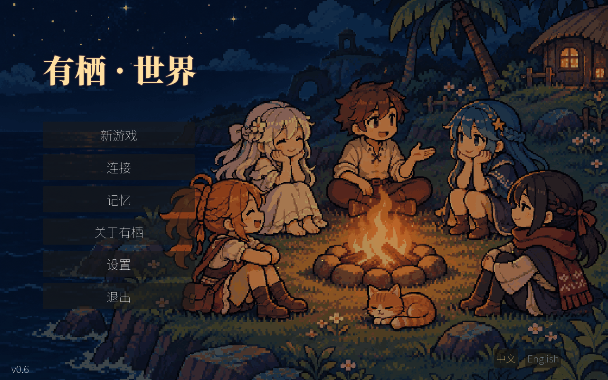
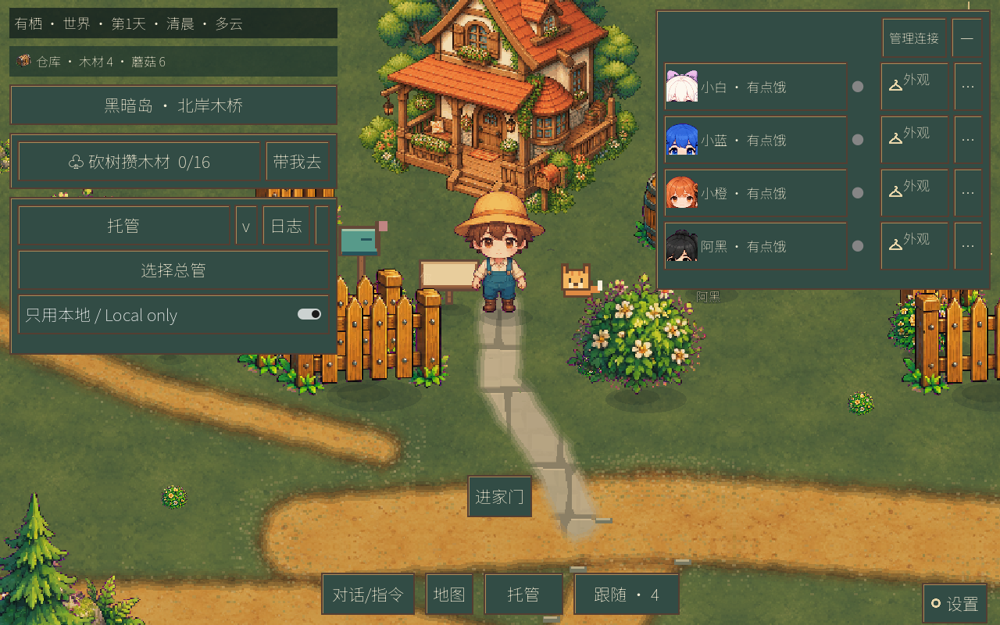
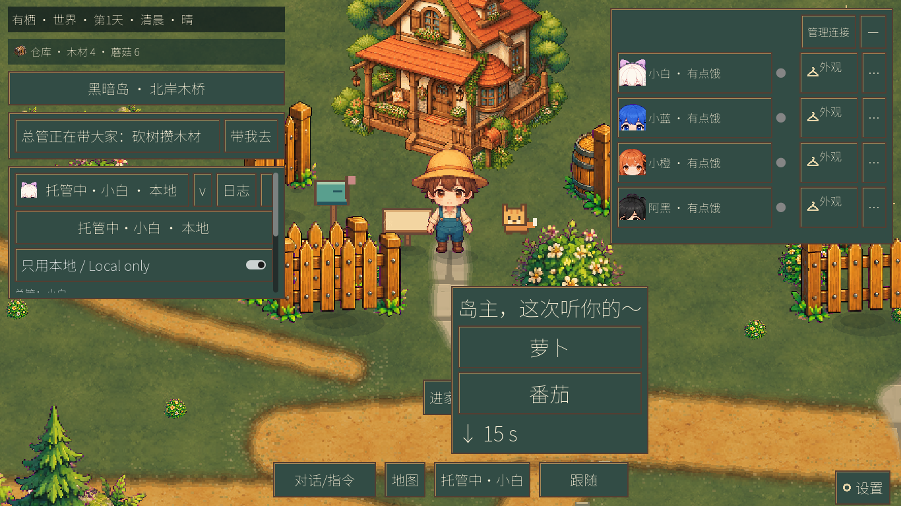
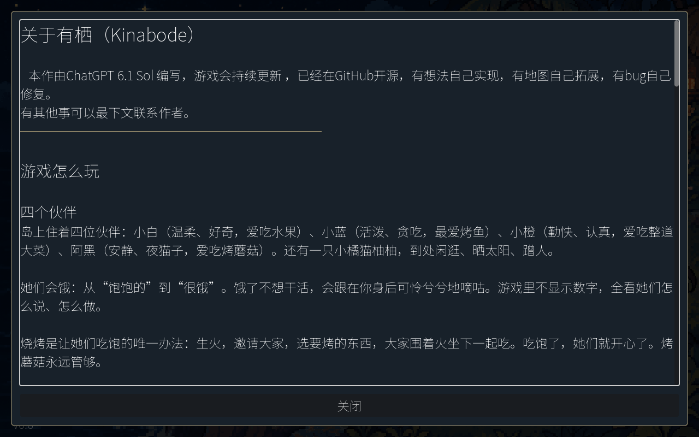

# 有栖 / Kinabode · v0.6.1

一个人带着四个饭桶在海岛上生活。种菜、钓鱼、烧烤、下棋、玩小游戏，慢慢把岛变成家。

A quiet island home for you and four hungry companions. Grow crops, fish, share a barbecue, play board games and make a home together.

上图开始页、关于与正式开局来自 v0.6.0 导出验证；托管图来自 v0.6 开发验证。v0.6.1 游戏包与验证结果见 [CHANGELOG](CHANGELOG.md)。 / These start, About and standard-opening captures are from v0.6.0 verification; the stewardship capture is from v0.6 development. See [CHANGELOG](CHANGELOG.md) for v0.6.1 packages and validation.

## 运行 / Run

安装 **Godot 4.7.2**，导入并运行 `godot/project.godot`。首次打开会导入资源。点击编辑器右上角运行项目（F6 是运行当前场景，F5 是运行整个项目）；项目从 `scenes/title.tscn` 开始，岛上场景为 `scenes/main_v3.tscn`。下载游戏包可直接打开；源码开发需安装 Godot。

Install **Godot 4.7.2**, import `godot/project.godot` and run the project. The first launch imports its resources. Use Run Project (F5), starting at `scenes/title.tscn`; the island scene is `scenes/main_v3.tscn`. Download a release package to play directly; Godot is needed only for source development.

**不接 AI 也能完整游玩。** 新游戏默认正式开局；人物、物资和路线遵守同一套真实规则。开始页“关于有栖”可阅读完整玩法与作者的话，也可直接阅读[关于有栖](docs/about.md)。

**The complete game works without AI.** New games use the standard opening. Every resident uses the same physical resources and routes. Open “About Kinabode” for the full introduction and author's note, or read [About Kinabode](docs/about.en.md).

## 可选 AI / Optional AI

在游戏的居民连接页选择本地、Codex 或 GPT API。API 地址由玩家填写，密钥放自己的本地配置或环境变量；请勿提交密钥、个人会话、存档或连接配置。连接、推理与接受任务是不同状态；等待和失败不会伪造模型回复。

Use the resident connection page to select local intelligence, Codex or a GPT API. Enter your own API endpoint and keep credentials in your local configuration or environment. Never commit keys, personal conversations, saves or connection settings. A connection does not prove inference, and an accepted job is not a completed job.

## 验证与贡献 / Checks and contributions

Python 3 与 Godot 放在 PATH 后，运行 `scripts/test-quick.sh`（Windows：`python scripts/test_quick.py`）。完整测试、翻译规则和合并请求流程见 [CONTRIBUTING](CONTRIBUTING.md)。游戏设计见 [DESIGN](docs/DESIGN.md)，未来方向见 [ROADMAP](ROADMAP.md)。

With Python 3 and Godot on PATH, run `scripts/test-quick.sh` (Windows: `python scripts/test_quick.py`). See [CONTRIBUTING](CONTRIBUTING.md) for the full suite, translation rules and pull requests. Read [DESIGN](docs/DESIGN.md) and [ROADMAP](ROADMAP.md) for the project's direction.

作者只在 **MacBook M1 8GB** 上测试过，其他设备不保证，欢迎反馈。生命孕育尚未经过长时间真实模型试跑，成本和长期稳定性没有完成验证。

The author has tested only on a **MacBook M1 with 8GB RAM**. Other devices are not guaranteed; reports are welcome. Lifeblood has not undergone a long real-model soak test, so its long-term stability and costs remain unverified.

## 授权与声明 / License and credits

本项目自己制作的代码、内容及新增美术按 [MIT](LICENSE) 发布；第三方素材保留原授权，详见 [CREDITS](CREDITS.md)。字体为 OFL，部分音效 CC0，音乐 CC BY 4.0；旧音色渲染音乐另有 GPL 标注。

Project-authored code, content and new artwork are under [MIT](LICENSE). Third-party material retains its own license; see [CREDITS](CREDITS.md). Fonts use OFL, some sound effects use CC0, music uses CC BY 4.0, and legacy soundfont-rendered tracks retain their recorded GPL notice.

八套外观设计来自中国网友同人创作，本项目为致敬、与相关公司无关；原作者如有异议请联系，我们会立即删除。原作者姓名与原设计再发布许可尚未完整留档，详见 CREDITS。

Eight appearance designs derive from Chinese community fan art. This project is a tribute and is unaffiliated with the relevant companies. Original artists may contact us with concerns; we will remove the material immediately. Artist identities and original redistribution permissions are not fully documented; see CREDITS.

联系方式 / Contact: **抖音 / Douyin: MercuryFantasy**。[GitHub](https://github.com/shuixingking/kinabode)。
