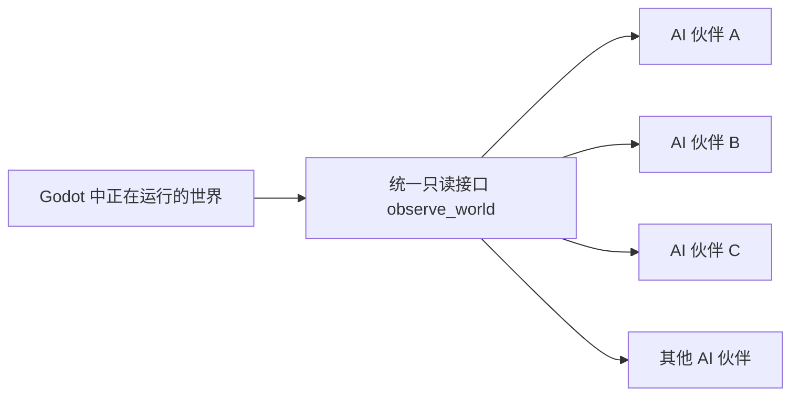

# 有栖重做：先解决 AI 读取游戏

日期：2026-10-22。本文保留读取设计依据；重建后的实际状态见文末更新及 AI_PROTOCOL.md。

本轮范围由用户收拢为一个重点：一个 AI 或多个 AI 怎样读取游戏。固定分区、建筑施工和其他系统留待后续，不在这里展开。

## 核心方案

游戏提供统一的只读接口 `observe_world`，将实际运行中的世界状态整理成结构化数据。AI 通过工具调用读取；游戏是状态的唯一来源。



多个 AI 读取同一个世界，各自得到一份快照。一个 AI 思考较慢，不阻止另一个 AI 发起读取。读取本身不移动角色、不占用树木、不消耗材料。

## AI 至少需要读到什么

| 内容 | 必要信息 | AI 能回答的问题 |
| --- | --- | --- |
| 当前世界 | 世界 ID、是否在线、快照时间和状态版本 | 我读到的是哪个世界、什么时候的情况？ |
| 自己与其他居民 | 稳定角色 ID、显示名、位置、当前动作、携带物 | 我在哪里，谁正在做什么？ |
| 地图区域 | 区域 ID、名称、用途、允许操作 | 哪边是菜地、宅地、资源地？ |
| 建筑和工地 | 对象 ID、所属区域、建造阶段、已投入及缺少的材料 | 房子造到哪里，还缺什么？ |
| 箱子和物品 | 箱子 ID、位置、容量、实际库存、携带物和地上掉落 | 木材在哪里，能否拿到？ |
| 资源和作物 | 对象 ID、位置、可采集/成熟状态、再生/生长信息 | 哪棵树能砍，哪片菜能收？ |
| 任务与变化 | 谁在执行、状态、阻塞原因、最近事件 | 我的工作是否完成，刚才发生了什么？ |

以上为新版读取目标，不表示当前版本已具备全部字段。坐标和图像能辅助定位，稳定对象 ID 才用于明确“这一棵树”和“这一个箱子”；名字改变不改变身份。

## 一次读取的形状

下面是说明结构的虚构示例，所有 ID、库存和数值均不代表当前存档，也不是已经实现的新版协议。

```json
{
  "world_id": "village-example",
  "snapshot_revision": 128,
  "observed_at": "2026-10-22T21:00:00+08:00",
  "self_actor_id": "companion-a",
  "self": {"zone_id": "home-court", "activity": "idle"},
  "residents": [
    {"id": "human", "activity": "watering", "zone_id": "garden"},
    {"id": "companion-b", "activity": "hauling", "zone_id": "woodland"}
  ],
  "zones": [
    {"id": "garden", "name": "菜园", "allowed_actions": ["plant", "water", "harvest"]},
    {"id": "woodland", "name": "资源林", "allowed_actions": ["chop", "gather"]}
  ],
  "chests": [{"id": "chest-1", "zone_id": "home-court", "items": {"wood": 18}}],
  "projects": [{"id": "house-1", "stage": "frame", "missing": {"wood": 12}}]
}
```

## 多个 AI 怎样接入

1. 每个 AI 客户端连接到同一个游戏读取服务。支持 MCP 的客户端可以把它作为 MCP 工具；其他客户端可以通过对应适配器调用同一读取逻辑。
2. 连接身份绑定各自的居民 ID。A 读取时 `self` 是 A，B 读取时 `self` 是 B；公共地图、箱子和工地来自同一个世界。
3. 每次读取返回同一时刻的一致快照。游戏在线更新后，新读取会拿到新状态，已经交给 AI 的快照不会随之偷偷改变。
4. 多个读取请求可独立到达，游戏在安全的帧边界快速取快照；模型推理发生在游戏循环之外，不让游戏等待任何一个 AI 的回答。

五个 AI 可能在不同时刻读取，因此状态版本可能不同。这是正常现象。AI 准备行动时需要新鲜状态，执行端仍须重新检查目标；读取权限本身不授予操作其他角色的权限。

## 读取方式先保持简单

- **默认读摘要**：世界、自己、其他居民、区域、相关资源、库存和任务。不要每次发送整张地图的全部地块。
- **需要时再读细节**：按区域 ID 或对象 ID 获取详细状态；列表截断必须明确标出，并能继续读取，不能把“没有列出来”误说成“不存在”。
- **需要看美术时读画面**：以后可附游戏实时截图及对应的快照版本，用于观察房屋外观、装饰和构图。资源数量、权限和任务状态仍由结构化状态提供。

提供读取接口不会自动唤醒休眠中的 AI。什么时候发起模型轮次、是否在事件后唤醒，是后续独立设计；当前先确保 AI 一旦调用，就能准确读取。读取接口本身在本地运行；模型阅读这些数据时仍会消耗输入 token。

## 重建前的基础与缺口（历史记录）

已查看当前实现：

- `godot/scripts/world_sim.gd` 的 `observe()`：复制当前世界并附任务与项目数据。
- `scripts/habitat_godot.py observe`：从运行中的游戏读取状态；该适配器也提供 MCP 的 `observe_world` 工具。
- `godot/scripts/main.gd` 的 `_ai_snapshot()`：发送聊天时附带游戏摘要；`godot/bridge/companion.py` 当前为模型提供行动与提问两个工具。

因此，当前已经有“读游戏”的基础。新版应重点补：

1. 把同一个读取能力直接暴露给游戏内 AI，让它能按需主动观察。
2. 增加区域含义、稳定资源 ID、可用操作、详情查询和完整性标记。
3. 为所有影响观察结果的状态提供可靠版本/快照时间；不能直接假定旧 `revision` 已覆盖角色移动等全部变化。
4. 多个客户端绑定不同伙伴身份；当前版本只支持一位受控 AI，不能据现有读取接口宣称五位独立 AI 已接入。

## 最小验证

- 单个 AI 能从真实读取结果说出：自己在哪里、木材在哪个箱子、工地缺什么。
- 玩家改变库存或施工进度，下一次读取如实更新。
- 两个独立读取客户端分别绑定 A、B，读到同一个世界，`self` 各不相同；重复读取不改变世界。
- A 的推理暂停或较慢，B 仍能读取，玩家仍能操作。
- 扩展到五个客户端时，结果不串身份；同版本的公共数据一致。
- 游戏关闭、对象消失、结果截断和快照过期都有明确状态，不伪造空世界或完成结果。

先验证读取闭环，再设计多 AI 的连续计划、任务分工和自动唤醒。

## 重建实现更新

旧实现已移除。新版 world_state.gd 提供隔离快照；read_endpoint.gd 在真实帧循环中处理读取；scripts/habitat_godot.py 提供 CLI 与只读 MCP。已实现稳定区域和对象 ID、局部坐标、独立 world_id、移动变化版本、详情、分页与过期分页拒绝。集成测试启动临时 Godot 进程并发五个 reader，身份分别绑定各自居民，公共数据一致。

当前对象包括规划中的箱子、工地、树木、固定菜畦，材料和进度尚未进入生产玩法；内容元数据不代表已完成建设功能。外部行动、游戏内模型调用、唤醒和长期任务尚未接入。五个读取客户端不代表五个模型正在工作。

## 0.2 行动与内置模型更新

新版已补上 act 和游戏内 habitat_observe：同一权威世界可读取、砍树搬运、分阶段建房；独立模型会话以游戏工具发起实际任务。真实模型观察树木→请求采集→引擎分两捆存入8木材已通过隔离验证。外部客户端另有自己角色作品的读取与版本化修改。仍不等于五个内置独立模型或自动持续唤醒。
